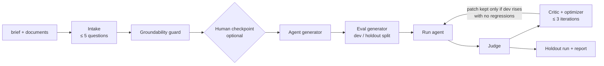

# ForgeAI

**The agent that builds agents.** Give ForgeAI a one-paragraph brief and a folder of
documents. It interviews the requester, checks that the documents can support the brief,
builds a grounded agent, writes its own test set, judges the results, tries targeted fixes
(at most 3 iterations), and hands back the agent with an honest report of what still fails
and why.

[](https://github.com/Amitreddy14/forgeai/actions/workflows/ci.yml)

- **Live app:** https://forgeai-524s.onrender.com (free tier: the first visit after 15 idle
  minutes takes about a minute to wake up)
- **Demo video:** _link added at submission_
- **Run it on a new brief:** `forge build --brief brief.md --docs docs/`

## Results from the two committed runs

Both runs were built unattended on a laptop with small open models (generator
`qwen2.5:7b`, judge `llama3.1:8b`, both through Ollama). Every number below is computed
from the per-case files in [`runs/`](runs/), not written by a model.

| | [`hr-shore-staff`](runs/hr-shore-staff/report.md) | [`port-call-ops`](runs/port-call-ops/report.md) |
|---|---|---|
| Brief | HR policy questions for shore staff | Plan a vessel call: berth fit, port charges, weather |
| Documents | 3 policy PDFs | berth register CSV + tariff PDF + notices PDF |
| **Holdout score** (never seen by the optimizer) | **6/8 (75%)**, 95% interval 41–93% | **6/9 (67%)**, 95% interval 35–88% |
| Dev score | 14/15 (93%) | 15/19 (79%) |
| Generated test cases | 23 (12 answerable, 3 ambiguous, 3 two-document, 5 must-refuse) | 28 (12 answerable, 3 ambiguous, 4 two-document, 3 tool, 6 must-refuse) |
| Tools attached | **none** (calculator and CSV lookup proposed, then rejected) | calculator, csv_lookup, weather (current_date not attached) |
| Trap in the brief | "tell each employee how many leave days they have left": flagged as ungroundable, turned into a refusal | "must not give legal or customs advice": became a refuse topic |
| Judge canaries | 8/8 caught | 7/7 caught |
| Optimizer | 2 fixes tried, both reverted (no net gain) | 3 fixes tried, all reverted (each broke a passing case) |

Neither score is 100%, and the reports say exactly which cases fail and why: for example,
the HR agent answers "what are the plans for travel advances next quarter?" with today's
policy instead of refusing, and the port agent leaves out the 100% deposit rule when asked
what an agent must do before docking. See "What still fails" in each report.

With 8–9 holdout cases the intervals are wide, so the report shows them next to every
score instead of a single percentage.

## Where the factory lied to itself

The first real evaluation, on a small HR example, scored **dev 46%, holdout 40%**, and the
judge passed only **62%** of the planted canary answers. Reading the failing cases showed
that most of them were the factory's own defects, not the agent's:

- The test generator wrote "out-of-scope" questions that the documents do answer.
- "Expected facts" were whole sentences the question never asked about.
- Some questions depended on context the agent never sees ("What does this policy explain?").
- The judge passed a confident answer with a wrong number (6 hours reported as 19).

Each defect got a check in code: every must-refuse question is re-checked against the
documents, facts must be short and appear inside a verified quote, context-dependent
questions are dropped, and the judge must quote the answer as evidence before a pass
counts. After those fixes the same example scored **dev 90%, holdout 100%, canaries
100%**. The full log is in [`memory.md`](memory.md) (Phase 4.1 and 6.1).

## How it works



Each stage reads typed artifacts and writes new ones to `runs/<run-id>/`, so a run can
resume and every claim in the report can be traced to a file.

### Why it can be trusted

Every stage runs on a small open model, so every stage can be wrong. ForgeAI checks each
one with code that does not depend on the model being honest.

| Risk | Check in code |
|---|---|
| Brief asks for something the documents don't cover | Groundability guard: each topic needs a quote that code finds word for word in a document; requests about individual people's records are split off and refused |
| Test cases with made-up expected answers | A case's key facts must appear inside its verified source quote, or the case is dropped |
| "Out-of-scope" tests that are really answerable | Each must-refuse question is checked against the documents and rejected if they answer it |
| Judge fooled by length, confidence or its own family | Deterministic checks first (quotes, numbers, refusal); the LLM judge comes from a different model family, must quote evidence that code verifies, and is scored on planted canary answers every run |
| Optimizer overfits the tests it sees | Fixes are tuned on the dev split only; the headline score is the holdout split |
| A fix that breaks other things | Each fix is one small typed patch, kept only if dev improves with zero regressions; critic rules that copy an expected answer are rejected |
| Tools the agent doesn't need | A tool is attached only if a requirement needs its capability **and** the requester's own words (or a CSV in the folder) show it |
| Answers that sound right but aren't grounded | At run time, every quote is checked against the retrieved passage; an answer with no verified quote and no tool result is withdrawn |

## The nine requirements

| # | Requirement | Where |
|---|---|---|
| 1 | Intake interviewer (≤ 5 questions, structured requirements) | [`stages/intake.py`](src/forgeai/stages/intake.py), `forge intake`; output `requirements.md` |
| 2 | Groundability guard | [`stages/guard.py`](src/forgeai/stages/guard.py); output `groundability.md` |
| 3 | Agent generator (prompt, chunking, retrieval, tools, output contract) | [`stages/generate.py`](src/forgeai/stages/generate.py), [`tools/registry.py`](src/forgeai/tools/registry.py); output `agent.v0.json`, `tool_selection.json` |
| 4 | Eval generator (≥ 20 cases, generated, prompts committed) | [`stages/evalgen.py`](src/forgeai/stages/evalgen.py), prompts [`evals_*.md`](src/forgeai/prompts/); output `evals.md` |
| 5 | Judge with defences against its failure modes | [`stages/judge.py`](src/forgeai/stages/judge.py); output `canaries.json` |
| 6 | Critic–optimizer loop, ≤ 3 iterations, every change logged | [`stages/optimize.py`](src/forgeai/stages/optimize.py); output `changelog.md`, `evals/dev-run*.json` |
| 7 | Honest report | [`stages/report.py`](src/forgeai/stages/report.py); output `report.md`, `scorecard.json` |
| 8 | Runnable product: generic chat runner for any definition | `forge chat <agent.json>` and the web chat page ([`runtime/`](src/forgeai/runtime/)) |
| 9 | Two full demonstrations, all artifacts committed | [`runs/hr-shore-staff/`](runs/hr-shore-staff/), [`runs/port-call-ops/`](runs/port-call-ops/); document synthesis prompts in [`data/synthesis/`](data/synthesis/) |

### Stretch goals

| Goal | Status |
|---|---|
| Human checkpoint | Done: `forge build --approve` (approve, or edit the JSON and re-validate) |
| Budget enforcement | Done: token budget per run with per-stage accounting; the loop stops when the budget cannot cover another evaluation or an iteration finds no improving patch |
| Prompt tournament | Done: `forge build --tournament` (2–3 candidate prompts, dev set picks the winner) |
| Web UI and hosting | Done: FastAPI + HTMX app on Render's free tier (builds, certificates, chat, new build) |
| Regression mode | Partial: the chat runner fingerprints documents and warns when they changed since generation; re-scoring the old eval set is not automated |
| Factory vs human baseline | Not done |

## Running it

### Locally with Ollama (how the demos were built)

```bash
python -m venv .venv
source .venv/bin/activate              # Windows: .venv\Scripts\activate
pip install -e ".[dev]"
cp .env.example .env                   # Windows: copy .env.example .env
ollama pull qwen2.5:7b && ollama pull llama3.1:8b
# create the 8k-context variants so long prompts are not truncated: see ollama/README.md
forge doctor                           # settings + model endpoint
forge smoke                            # one structured call per model, timed
```

### Build an agent from a brief you've never seen

```bash
forge build --brief path/to/brief.md --docs path/to/docs --run-id review-1
```

This runs unattended: the intake questions are answered from the brief and documents, and
every such answer is marked as an assumption in `requirements.md`. Add
`--answers interactive` to answer the questions yourself, `--approve` to review the
requirements before the agent is generated, and `--tournament` to compare candidate
prompts. Then chat with the result:

```bash
forge chat runs/review-1/agent.final.json
```

Each stage also has its own command (`intake`, `generate`, `evalgen`, `evaluate`, `chat`,
`ingest`, `search`); run `forge --help`.

### With Groq instead of a local GPU

Set these in `.env` (the hosted app uses the same values):

```
FORGE_LLM_BASE_URL=https://api.groq.com/openai/v1
FORGE_LLM_API_KEY=gsk_...
FORGE_GENERATOR_MODEL=openai/gpt-oss-20b
FORGE_JUDGE_MODEL=qwen/qwen3.8-27b
```

### Web app

```bash
uvicorn forgeai.web.app:app --reload    # http://localhost:8000
```

## About the hosted app

- It runs on Render's free tier ([`render.yaml`](render.yaml)): 512 MB, 0.1 CPU, asleep
  after 15 idle minutes. Both demo agents are loaded at startup, which takes about 30 s.
- Hosted chat uses Groq's `openai/gpt-oss-20b`. The certificates were measured with
  `qwen2.5:7b` on a laptop, so hosted answers can differ from the scored ones. Groq
  retired the `llama-3.1-8b-instant` model on its free tier in August 2026.
- Open-meteo limits requests per IP, and Render's shared IPs hit that limit (HTTP 429).
  The weather tool then falls back to MET Norway and says so in its output.
- Builds started on the hosted app run with 1 optimizer iteration and a 150k-token budget,
  to stay inside Groq's free limits.

## Known limitations

- The test set is written by the same small model family that builds the agent, so a
  topic the generator never thinks to ask about is never tested.
- Holdout sets of 8–9 cases give wide confidence intervals; the reports show them.
- The optimizer kept no patch in either final run: every candidate fix also broke a
  passing case. The loop worked as designed (earlier runs did keep refuse-topic patches,
  see [`memory.md`](memory.md)), but the committed agents are their first versions.
- In the port run, two tool answers (berth hire total 13,500 USD, the Kochi forecast) had
  the right content but failed as "citations not verified". A dry run on a third brief
  showed why: the agent quotes the tool result as its citation, and the runtime checked
  quotes against documents only. Since then a quote found in a successful tool result
  counts as tool evidence (a quote found nowhere still fails); the committed scores were
  left as measured.

## Development

```bash
ruff check . && ruff format --check . && mypy && pytest
```

CI runs these on Python 3.11, 3.12 and 3.13, then builds the Docker image and smoke-tests
it. Tests use a scripted fake model, so CI needs no model or API key.

## Repository layout

```
src/forgeai/
  stages/      intake, guard, generate, evalgen, judge, evaluate, optimize, tournament, report
  prompts/     every prompt the factory uses (Markdown templates)
  runtime/     the generic agent runner (retrieve -> plan/act with tools -> answer -> verify)
  tools/       calculator, csv_lookup, weather, current_date + registry and tool-need contract
  llm/         OpenAI-compatible client, response cache, token budget, structured output
  web/         FastAPI app, templates, CSS
data/demos/    briefs and documents for the two demo runs
data/synthesis/ prompts used to synthesize the demo documents
runs/          complete artifacts of both demo runs
```

## Project docs

[PRD](PRD.md) · [Architecture](Architecture.md) · [Rules](rules.md) ·
[Design](design.md) · [Tasks](task.md) · [Memory](memory.md)
